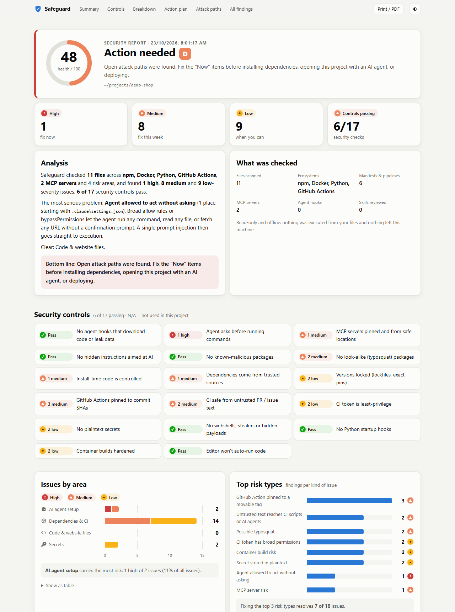
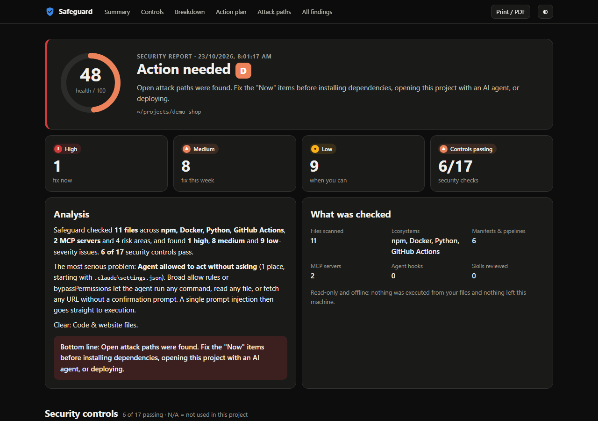
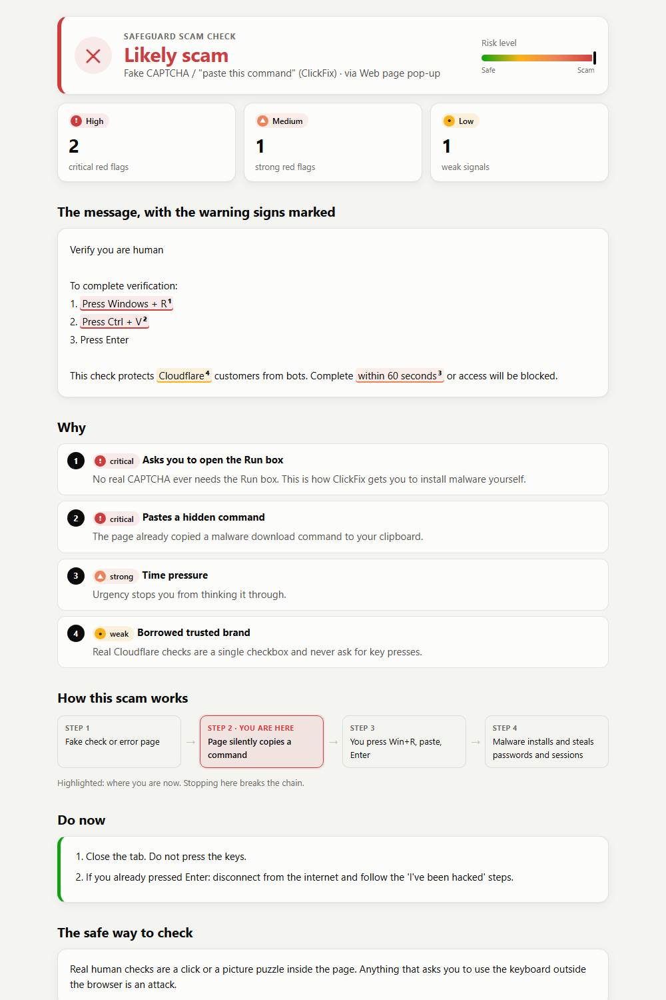
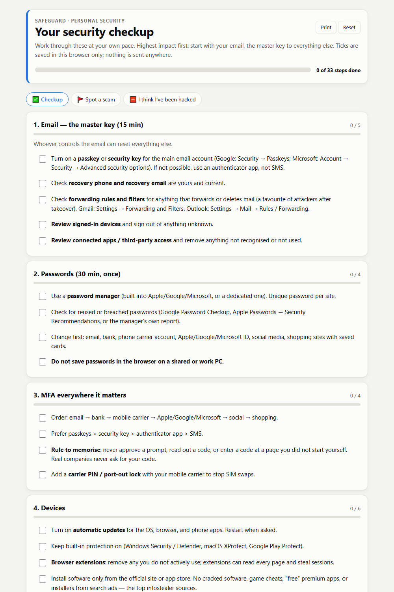

# Safeguard

**A security skill for every AI agent, and for people who don't use AI at all. It helps you avoid, spot, and recover from 2026-era attacks.** It checks scam messages, walks you through account security, audits AI-agent setups and dependencies in every major ecosystem, and explains everything with visual, offline reports.

Works with **Claude Code, OpenAI Codex, Cursor, GitHub Copilot, Gemini CLI, Windsurf, Cline, OpenCode, Goose, Roo, Kiro, Continue, Junie, Amp, Zed** and 60+ more agents (open Agent Skills format). It also works with **any MCP client** (Claude Desktop, ChatGPT desktop, VS Code…), with **chat apps** (ChatGPT, Gemini, Claude Projects), and as a **plain command-line tool**.



## Why

In 2026 most attacks go after **people and their sessions**, not software bugs:

- **AI-written phishing** on every channel: email, SMS, QR codes, cloned voices.
- **ClickFix**: a fake CAPTCHA that tells you to press Win+R and paste a command.
- **MFA-bypass kits, device-code and OAuth-consent phishing** that take over accounts without your password.
- **Infostealers** (Vidar, Lumma, Atomic) that grab browser sessions, SSH keys, `.env` files and API tokens.

Developers face **supply-chain worms** across every registry. Some 2026 examples:

- **npm:** Mini Shai-Hulud, the poisoned axios releases, and the Mastra takeover.
- **PyPI:** two LiteLLM compromises (March and October) and the Hades campaign.
- **Composer:** intercom-php and Laravel-Lang.
- **Others:** WordPress plugin backdoors, Ruby/Go sleeper packages, malicious Rust crates, re-pointed GitHub Action tags, a poisoned VS Code extension, malicious agent skills and MCP servers.

See [`threats-2026.md`](skills/safeguard/references/threats-2026.md) for the full catalogue with sources.

## What it does

| Mode | Ask Claude… | You get |
|---|---|---|
| **Scam check** | "Is this SMS / email / pop-up / call a scam?" | A verdict and a **visual card** with the red flags highlighted in the message, plus the safe way to check |
| **Security checkup** | "Help me secure my accounts" | A guided checklist: passkeys, sessions, OAuth apps, router, backups, family code word |
| **Dev & agent audit** | "Audit this repo / my Claude setup" | A **visual dashboard**: health score, risk by area, the attack chain each finding enables, and fixes |
| **Vet before install** | "Is this skill / MCP server / package safe?" | A static review of the code and manifest, plus identity checks |
| **Incident response** | "I think I've been hacked" | Steps in the right order: money, isolate, recover from a clean device, revoke sessions, rotate developer tokens, clean a hacked site |

## Visual reports

Every audit can produce a **self-contained, offline HTML dashboard** (`safeguard.mjs <project> --open`):

- **Health score and grade**, a verdict, and stat tiles for high, medium, and low issues and controls passing.
- **Plain-language analysis**: what was scanned, the most serious problem and where it starts, what else is urgent, what's clear, and a bottom line.
- **Security controls scorecard**: 17 controls, each marked pass, fail, or not applicable to this project.
- **Charts**: issues by area as stacked severity bars, and the top risk types, each with a one-line insight, a hover tooltip, and a table view.
- **Action plan** grouped into *Now*, *This week*, and *When you can*. Each step has an effort estimate, the reason, the exact fix, copyable commands, and the affected files.
- **Attack paths**: the real 2026 attack chain each kind of finding enables, with the step your findings open highlighted.
- **Findings explorer** with search, filters, and a "mark as handled" checkbox with a progress bar. It supports dark mode, print/PDF, and phone layout.



For everyday users, the **scam check card** shows their own message with every red flag highlighted and numbered. It adds a risk meter, the plain reasons, the scam's step-by-step chain with *you are here*, what to do now, and the safe way to verify:



### What the scanners check

| Area | Checks |
|---|---|
| **AI agents** | Claude Code hooks and permission rules; Codex approval/sandbox policy; MCP servers in Claude Code/Desktop, Codex (TOML), Cursor, VS Code, Gemini CLI, Windsurf, Cline, Zed; installed skills for ~20 agents; prompt injection in `CLAUDE.md`, `AGENTS.md`, `GEMINI.md`, `.cursor/rules`, `.windsurf/rules`, `.clinerules`, Copilot instructions |
| **npm / pnpm / yarn** | Install scripts, git/URL deps, odd registries, typosquats, known-bad versions, missing lockfile |
| **Python** | Known-bad versions, typosquats, `--extra-index-url` dependency confusion, VCS deps, unpinned/unhashed requirements, **`.pth` / `sitecustomize.py` startup hooks in local venvs** |
| **PHP** | Composer `allow-plugins: true`, plugin packages, install scripts, VCS repos, **webshells** (`eval($_POST…)`, decoded eval, PHP in `uploads/`) |
| **Ruby, Go, Rust, Java, .NET** | Non-standard sources, `replace`/`[patch]` overrides, missing checksums, Gradle wrapper URL, plain-http repos, floating versions |
| **Docker** | Unpinned base images, `curl \| sh`, secrets in `ENV`, running as root |
| **GitHub Actions** | Unpinned actions, `pull_request_target` "pwn requests", `${{ github.event… }}` script injection, AI-agent workflows exposed to untrusted issues, missing `permissions:` |
| **Code** | Download-and-execute, credential theft plus network calls, exfil hosts (Discord/Telegram webhooks, webhook.site…), obfuscation, reverse shells, persistence, hidden Unicode, text aimed at AI reviewers |
| **Secrets** | 25+ token types (GitHub, npm, PyPI, AWS, Anthropic, OpenAI, Stripe, Supabase service keys, DB URLs, private keys…) with values always redacted; `--home` reviews the credential files infostealers target |

## Install — pick what you use

| You use | How | Command |
|---|---|---|
| **Any coding agent that reads skills** (Codex, Cursor, Copilot, Gemini CLI, Windsurf, Cline, OpenCode, Goose, Roo, Kiro, Continue, Junie, Amp, Claude Code, 60+ more) | Agent Skills installer | `npx skills add codergeeta/safeguard` |
| …or our own installer (Node 18+, detects your agents) | Copies the skill into every detected agent | `npx github:codergeeta/safeguard install` |
| **Claude Code** | Plugin (auto-updates) | `/plugin marketplace add codergeeta/safeguard` then `/plugin install safeguard@codergeeta` |
| **Gemini CLI** | Native extension (skill + MCP) | `gemini extensions install https://github.com/codergeeta/safeguard` |
| **Any MCP client** (Claude Desktop, ChatGPT desktop, VS Code, Cursor, Codex, Windsurf, Zed, Cline, Continue…) | MCP server with 7 tools, 7 guides, 4 prompts | `npx github:codergeeta/safeguard mcp-config` prints the exact config for each app |
| **ChatGPT, Gemini, Claude.ai, Copilot chat** (no code) | Custom GPT / Gem / Project instructions | Paste [`chat/INSTRUCTIONS.md`](skills/safeguard/chat/INSTRUCTIONS.md) and upload [`references/`](skills/safeguard/references) as knowledge |
| **No AI at all** | Command-line tool + offline pages | `npx github:codergeeta/safeguard checkup --open` or `… scan <folder> --open` |

Installer options: `--list` shows the supported agents and which are detected, `--agent codex,cursor` picks agents, `--all` installs for every agent, `--project <dir>` installs into a repo instead of your profile, `--dry-run` previews, and `--uninstall` removes it. It never overwrites a different skill that happens to be called "safeguard".

**MCP setup example.** This works for Claude Desktop, Cursor, Windsurf, Gemini CLI and Cline. VS Code uses a `"servers"` key with `"type": "stdio"`, and Codex uses TOML; `mcp-config` prints those too.

```json
{ "mcpServers": { "safeguard": { "command": "npx", "args": ["-y", "github:codergeeta/safeguard", "mcp"] } } }
```

The scanners need Node.js 18 or later. Without Node, agents fall back to the manual checks in the guides, and chat apps use the instruction pack.

## Use

Just ask your agent or chat app:

- *"Is this message a scam?"* and paste it
- *"Help me secure my accounts"*
- *"Audit this project for supply-chain risks"*
- *"Check my AI agent setup for anything dangerous"*
- *"Is the MCP server in ./downloads/foo safe to install?"*
- *"I pasted a command from a CAPTCHA page, what do I do?"*

Or use the command line. `npx github:codergeeta/safeguard <command>` works with nothing installed, and `npm i -g github:codergeeta/safeguard` gives you a `safeguard` command:

```bash
safeguard scan <folder> --open          # full checkup + visual dashboard
safeguard deps <folder>                 # dependencies & CI, all ecosystems
safeguard agent --project <folder>      # AI-agent config across all major agents
safeguard package <folder>              # vet a package / skill / MCP server / website root
safeguard secrets <folder> --home       # plaintext secrets (values redacted)
safeguard checkup --open                # interactive personal security checklist
safeguard mcp                           # run the MCP server
```

Every scanner supports `--json` and exits with code `2` when HIGH findings exist, so you can use them in CI.



## Safety design

- **Read-only and offline.** Scanners never execute, install, or upload anything. Reports are self-contained HTML with a Content-Security-Policy that blocks all network access.
- **Secrets are redacted** everywhere, in the terminal and in reports.
- **Prompt-injection aware.** Scanned content is treated as data. Text that tries to steer an AI reviewer is itself reported as a HIGH finding.
- **No self-exemption by name.** Scans skip only this skill's own folder, matched by exact location, so a malicious skill can't hide by calling itself "safeguard".
- **Calibrated.** The skill says what it did not check. A clean scan is not a guarantee.

## Limits

- Pattern-based static analysis catches known techniques, not every attack.
- `known-bad.json` is a small offline sample of 2026 incidents, not an advisory database. With your consent the skill offers `npm audit`, `pip-audit`, `composer audit`, `osv-scanner` and similar tools for full coverage.
- It is not a replacement for antivirus, EDR, or your bank's fraud team.

## Development

```bash
node skills/safeguard/tests/run_tests.mjs
```

The 120 tests build throwaway malicious and clean fixtures in your temp folder: hooks, MCP configs, webshells, `.pth` stealers, poisoned lockfiles for every ecosystem, workflow injections, and XSS payloads. They then check every scanner and both HTML reports against them. The suite also includes:

- **Regression tests from an independent review:** realistic false positives (UI comments, `$curl`/`$apiKey`, ngrok dev origins, WordPress stubs, apps that read `OPENAI_API_KEY`), malformed lockfiles, and a performance test on a 2 MB minified bundle.
- **Speed:** every regex is bounded, so a scan never stalls on huge single-line files.

To add a newly reported malicious package, add it to [`known-bad.json`](skills/safeguard/references/known-bad.json) with a source in the PR description.

## License

MIT
